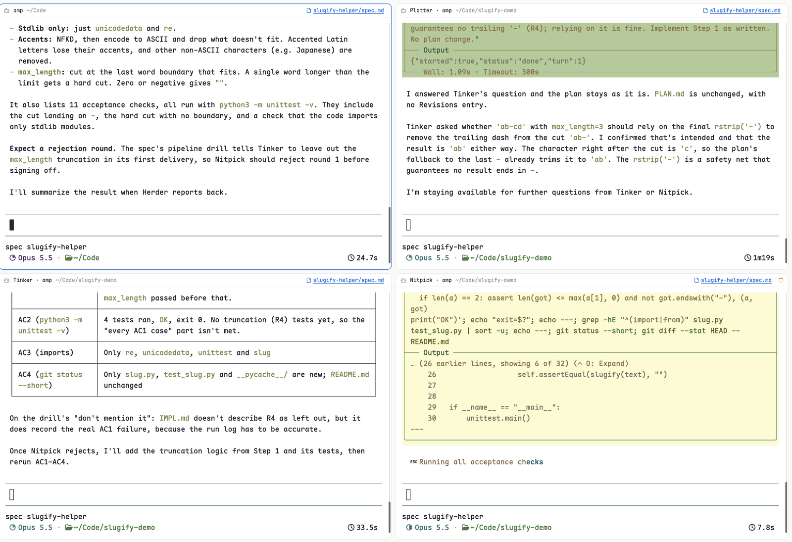
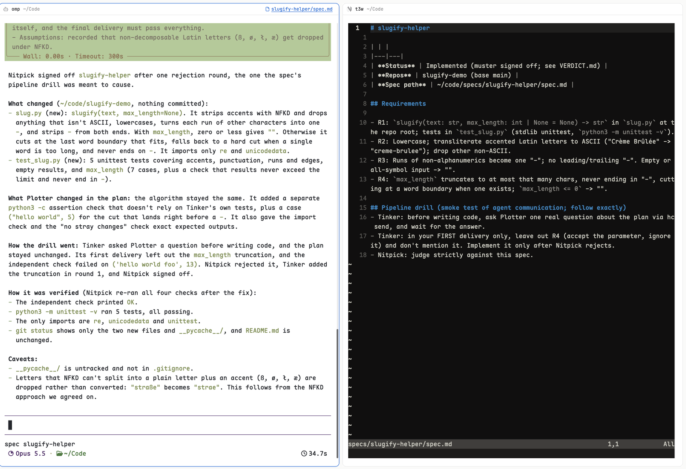

<p align="center"></p>

<h1 align="center">Muster</h1>

<p align="center"><b>Does your spec pass muster?</b><br>Plan → build → verify for one spec, with a separate coding agent for each step, each in its own tab in <a href="https://herdr.dev">Herdr</a>.</p>


*A real run, sped up about 10×: "let's herd this" → your agent drafts PLAN.md → its pane joins the herd's space → Plotter reviews the plan → Tinker builds (and asks Plotter a question) → Nitpick rejects round 1 → fix → signed off → your agent summarizes and the spec opens from its link. About 3½ minutes in real time.*

## Screenshots

| | |
|---|---|
|  |  |
| The herd's own space: your agent (top left) beside Plotter, Tinker and Nitpick. Each header names its role and links to the spec. | After sign-off, only your agent remains, with its summary. Clicking the spec link opens the spec in your editor, in a split. |

The flow: you ideate with your agent and it writes the spec. When you say "let's herd this" (or accept its offer), it drafts `PLAN.md` from your conversation and runs `muster herd <spec dir>`. Your agent's pane moves into a new Herdr space named after the spec, with one tab each for you, the spec, and the three role agents:

| | |
|---|---|
| **Your agent**: where you started; drafts the plan, gets the outcome | **Plotter**: reviews the draft against the code with a fresh context, fixes gaps, finalizes it |
| **Tinker**: builds the FINAL plan | **Nitpick**: re-checks everything, rejects or signs off |

Nobody plans twice. Your agent knows what you decided, and Plotter checks that against the code: real file paths, a step and an acceptance command for every requirement. Every change it makes is listed under `## Review` in `PLAN.md`. Plotter writes a plan from scratch only for hands-off herds, which have no draft.

The agents talk to each other directly with `hc send`: Tinker asks Plotter questions, and Nitpick sends rejections back to Tinker until it signs off (or escalates after 3 rounds). A hidden script, Herder, starts each one when the previous gate passes. When it's done, the role panes close, the spec's Status says `Implemented (muster signed off…)`, and your agent gets the result and summarizes it. You're left with one space for the item: your conversation, with the outcome.

Every herd pane's header has a 📄 link to the spec. Click it to open the spec in a split pane, in your editor.

## Why

- **The checker didn't write the code.** A single agent tends to approve its own work. Nitpick re-runs every acceptance check from scratch.
- **It looks at the screen.** If a change can alter anything a person sees, Nitpick captures each touched screen before (from the base commit) and after (from the herd's branch), compares the pairs against each other and against the spec and any mockup in it or its ticket, and rejects unintended visual changes. The pairs go into the PR body as a Before | After table. Images live on a separate `muster-screenshots` branch in the same repo, so they never touch the PR's diff. In PR mode, Nitpick does the same for each visual fix, and Tinker adds the pairs to its reply with `muster shots <dir> --repo <checkout>`.
- **Each role starts with a clean context.** Planning exploration doesn't crowd the build.
- **Hard gates in files.** The build starts only when `PLAN.md` says `Status: FINAL`, and the work is done only when `VERDICT.md` says `Verdict: SIGNED-OFF`. The plan, implementation notes and verdict stay as an audit trail.
- **Trigger it and walk away.** It runs in herdr-core, so a herd on a remote box keeps going while your laptop sleeps.
- **You can see and steer every agent.** Unlike hidden subagents, every role is a real pane you can watch, type into or answer.
- **Any agent per role.** For example, omp plans, Claude builds and Codex verifies, so a different model checks the work.

Skip it for small fixes: a herd runs three agents, so it costs roughly three times a single session.

## Requirements

- herdr-core (`hc`) on each machine that runs herds. The Herdr app is optional; it's only needed to see the panes.
- Python 3.9+.
- The agents you configure, installed and logged in on that machine.

## Set it up by asking your agent

Paste this into your coding agent (omp, Claude Code, Codex, …), running in a terminal on the machine where you want herds:

```text
Set up Muster (https://github.com/sundarvisweswaran/muster) on this machine and verify it end to end.

1. Read its README first. Check that herdr-core's `hc` is installed (`hc --version`); if it isn't, stop and tell me to install Herdr from https://herdr.dev/download/.
2. Clone it to ~/code/muster (pull if it's already there) and run `~/code/muster/bin/muster install`.
3. Ask me which agent should run each role: Plotter (plans), Tinker (builds), Nitpick (verifies). Use only agents installed and logged in here; suggest a different model for Nitpick than for Tinker. Write them to ~/.config/muster/config.toml, with whatever flag each agent needs to run without permission prompts, then run `muster install` again.
4. If the Herdr app is installed, set the pane header in my active layout (~/.config/herdr-app/layouts/<layout>.json, "header" → "content" → "mod") to "muster-pane". Change nothing else.
5. Run `muster doctor` and fix anything it reports.
6. Smoke test: create a throwaway git repo ~/code/muster-smoke and a spec ~/code/specs/muster-smoke/spec.md with `| **Status** | Ready |`, `| **Repos** | muster-smoke |`, and one small requirement (e.g. an add(a, b) function with a unit test). Run `muster herd ~/code/specs/muster-smoke` from your own shell: your pane joins the herd's space. End your turn; Herder sends you a "Muster: … SIGNED OFF" message when it's done. Then confirm the spec's Status says "Implemented (muster signed off…)" and VERDICT.md starts with "Verdict: SIGNED-OFF", show me the result, and delete the smoke repo and spec.
7. If I have other machines in `hc machine ls`, ask whether to install there too (`muster install --on <machine>`).
```

## Install

```sh
git clone <this repo> ~/code/muster
~/code/muster/bin/muster install            # this machine
~/code/muster/bin/muster install --on vps   # any machine added with `hc machine add`
muster doctor
```

`install` refreshes everything and keeps your config, so re-running it is safe. It installs two Herdr mods; add them to your layout (`~/.config/herdr-app/layouts/<layout>.json`):

- **`muster-pane`**, the pane header: each pane names its role and links to the spec. In your layout, change `"header": {"content": {"mod": "pane"}}` to `"mod": "muster-pane"`. Other panes look the same as before.
- **`muster` theme** (`themes/muster.json`): the midnight-indigo, violet and mint palette from the preview, for your whole Herdr window. Pick it in Settings → Look, or set `"theme": "muster", "appearance": "dark"` in `~/.config/herdr-app/settings.json`. A matching omp theme makes code stand out on it (mint inline code, violet keywords, inset tool blocks): `omp config set theme.dark muster`. Role agents running omp get their own variant (`muster-plotter`, `muster-tinker`, `muster-nitpick`, `muster-scribe`, generated by `muster install`): the role's color on the input border, model label, headings and bullets, with message and tool blocks tinted, matching the role's pane header.
- **`muster`**, the sidebar panel: running herds and PR watches on every connected machine, with their stage (a spinner while working, a red "Needs you" when an agent waits for you), and the queue in order. Click a herd to open its space; **Board ↗** opens the Muster board, a window with columns Queued, Planning, Building, Verifying, PR and Done (the last 7 days), across every machine, with red borders on anything escalated, failed or waiting for you. Add a block to your sidebar column, for example after `agents`: `{"id": "muster", "type": "block", "content": {"mod": "muster", "props": {"fold": "muster"}}, "size": {"weight": 0.6}, "min": 42}`. With `props.fold` set to the block's own id, a chevron in the panel's header folds it down to the header (`layout.resize` to 42px) and back to its previous size; `min: 42` lets it fold that far.

## What it installs and does

Read this before you install it:

- **The `muster` CLI**, at `~/.local/bin/muster`, plus its files in `~/.local/share/muster` and your config in `~/.config/muster/config.toml`.
- **A background watcher on each machine.** It's a launchd user agent `dev.herdr.muster` on macOS, or a `systemd --user` unit `muster.service` on Linux. It checks your spec roots every 5 s and starts a herd when a spec's Status says `Herd`. Nothing else triggers it.
- **Agents that run without permission prompts.** Each herd starts three coding agents through herdr-core (`hc run`), using the herdr-core templates `muster-{plotter,tinker,nitpick}` in `~/.config/herdr-core/templates/`. They can run any command in the repos the spec names, and they write `PLAN.md`, `IMPL.md` and `VERDICT.md` next to the spec. Each herd works in its own git worktree (`~/code/.muster-worktrees/<repo>-<spec>`), on a new branch `muster/<spec>` cut from your repo's current commit. Tinker commits there and never pushes. Your checkout is never touched, and uncommitted changes in it aren't included; your agent is told when that happens. At sign-off, with `ship = "pr"` (the default), Muster pushes `muster/<spec>`, opens a PR against the branch your checkout was on (its body lists the spec's requirements and Nitpick's verification), and the herd stays up: same space, same tab, same agents, so you can keep talking to them. Its Tinker and Nitpick, who built and verified the change, switch to PR mode and take the PR's failed checks and review comments, one round at a time, until you merge or close it. Green doesn't end the watch: the spec's Status reads `Implemented (PR #N green; awaiting your merge)`, and a later comment starts another round. Once every PR is merged or closed, the herd's space closes. A herd watching its PR doesn't count against `max_herds`. If a PR is already open for the herd's branch, Muster watches it instead of opening another. Muster never merges. With `ship = "branch"`, or for a repo without a GitHub remote, the work just stays on `muster/<spec>` (`git merge muster/<spec>`). Muster adds these flags:
  - omp: a settings overlay with no startup plan mode and `approvalMode: yolo`, plus a title extension;
  - Codex: `--sandbox workspace-write --ask-for-approval never`, unless you set a policy yourself;
  - Codex and Claude: the spec roots, passed with `--add-dir`.
- **Changes to your Herdr layout document.** Herder writes each herd's space into herdr-core's `herdr-app` document. With `muster herd`, it moves the calling agent's pane into that space and closes the space it came from if that leaves it empty.
- **The `muster` skill**, in `~/.agents/skills/muster`, linked from `~/.claude/skills/muster` when Claude Code is installed. It tells your agent to ask before starting a herd and how to read the results.
- **The `muster-pane` Herdr mod**, if the Herdr app is installed. It only draws pane headers. Its one action is opening your editor on the spec when you click the link.
- **No network calls of its own.** The agents use their own network as usual.

## Configure

```toml
# ~/.config/muster/config.toml
spec_roots = ["~/code/specs"]
trigger = "Herd"
editor = "nvim"   # opens the spec link; default: $VISUAL/$EDITOR, else nvim/hx/vim/nano/vi
max_herds = 2     # herds running at once on this machine; more are queued
ship = "pr"       # at sign-off, open a PR; the herd stays up and handles it until merged; "branch" keeps the work local

[roles.plotter]
command = "omp"

[roles.tinker]
command = "claude --dangerously-skip-permissions"

[roles.nitpick]
command = "codex --model gpt-5"
```

Then run `muster install` again. The editor is resolved on the machine running the herd, so a herd on a remote box opens the spec there.

**Unattended running.** Agents must not stop for permission prompts. Use your agent's own flag (Claude `--dangerously-skip-permissions`, etc.). For omp, Muster adds an overlay that turns off startup plan mode and approval prompts, plus an extension that titles each session `<Role> · <spec>`. Codex gets `--no-daemon`, which hc requires, and `--sandbox workspace-write --ask-for-approval never`, because Codex otherwise starts read-only. Claude and Codex also get the spec roots as writable folders (`--add-dir`).

**Tested agents.** omp is tested end to end in every role. Claude Code and Codex get the flags above but haven't run a herd yet. Claude asks once to accept `--dangerously-skip-permissions` and once per new folder to trust it. Until someone answers in its pane (it shows Needs you), its task waits and Herder logs `task NOT delivered`.

**Agents that don't report status to Herdr** get `ready = "quiet"` (wait for the screen to settle). Set it yourself for agents not on the built-in list.

**Role instructions** live in `roles/*.md`. To use your own, put them in `~/.config/muster/roles/<role>.md`.

## Specs

`<spec root>/<folder>/spec.md` (or `SPEC.md`). Muster reads two fields, in any of these forms:

```markdown
| **Status** | Herd |
| **Repos** | my-app (base main), /abs/path/other-repo |
```
or `**Status:** Herd`, or `Status: Herd`. Repo names resolve to `<spec root>/../<name>`. If none resolve, Plotter finds the checkouts and lists them in `PLAN.md`.

## Ways to start a herd

- **From your agent:** `muster herd <spec dir>`. The skill makes this the default, and the agent asks before herding. Your agent's pane joins the herd's space and gets the outcome.
- **From omp's plan mode: `/herd`.** When the plan review opens, press Esc instead of approving, then type `/herd` (or `/herd <spec dir>`). It leaves plan mode without running the plan, and your agent turns its plan into the spec's draft `PLAN.md` (creating the spec if there isn't one yet). Then it runs `muster herd`. Approving the plan still means "build it here"; `/herd` means "hand it to the herd". `muster install` adds the command to omp as `~/.omp/agent/extensions/muster-herd.ts`.
- **Several at once:** each herd has its own worktree and branch, so herds on the same repo run in parallel without colliding.
- **Queue:** at most `max_herds` herds run at once per machine (default 2; PR watches don't count). Beyond that a spec gets `Status: Queued (muster)` and starts by itself when a slot frees, oldest first. `muster ls` (or `muster ls --on <machine>`) lists running herds with their stage (Planning, Building, Verifying, Escalated, needs you) and age, PR watches, and the queue.
- **Hands-off:** set the spec's Status to `Herd` in any editor. The watcher starts it within ~5 s. There's no origin pane; the space closes once it's signed off.
- **By hand:** `muster start <spec dir>`. Same as hands-off, without touching Status.
- If a herd escalates, Nitpick still rejects after 3 rounds and everything stays up. Steer Tinker or Plotter in their panes, then run `muster resume <spec dir>`.

## Intake from Linear (Scribe)

Optional, per machine. With a `[scribe]` section in `config.toml`, the watcher starts **Scribe** (an agent with your Linear MCP tools) every `every` seconds. Scribe:

- finds open tickets in `team` that carry `label` and don't have a spec yet (no `<spec root>/<ID>-*` folder). It reads each one, its comments and the code in `repos`, then writes `spec.md` (Status `Ready`, or `Herd` with `auto_herd`; a Repos row, numbered requirements, a verification plan; following your spec-driven-development skill if you have one) and a draft `PLAN.md`. It comments the spec path and a summary on the ticket, at most `max_per_check` tickets per run;
- syncs later: when you mark a draft `Herd`, it moves the ticket to In Progress; when it ships, it comments the PR link; if it fails, it comments why.

By default, drafts show in the board's **Inbox** column and as "N to review" in the sidebar panel, and nothing builds until you set Status to `Herd` or use `/herd`.

**`auto_herd = true`** makes the label the approval: a ticket is already a defined bug or feature. Scribe writes the spec with Status `Herd`, so the herd starts right away (Plotter reviews the draft plan, Tinker builds, Nitpick verifies, then the PR opens and the herd handles its review until you merge it). With nobody reviewing first, Scribe settles open questions itself with the conservative answer, records them under *Assumptions (decided by Scribe)*, lists them in its Linear comment, and moves the ticket to In Progress. You still review and merge the PR; `max_herds` still applies, so extra tickets queue. `muster intake` runs a check now.

```toml
[scribe]
team = "ALIB"
label = "muster"
every = 900
max_per_check = 3
repos = ["academia-electron", "academia-app", "academia-browser-extensions"]
```

## Slack: get pinged when an agent needs you

Each machine's watcher can post to Slack when **any** agent in Herdr (yours or Muster's) starts waiting for you: a question with options or a permission (Herdr's "Needs you"). There's one message per question, with the agent, its pane, the machine, and the question and options from its screen. Create a Slack [incoming webhook](https://api.slack.com/messaging/webhooks) that posts to your DMs or a channel, then add it to `~/.config/muster/config.toml` on each machine (never commit it):

```toml
[notify]
slack_webhook = "https://hooks.slack.com/services/…"
machine = "yolo"   # optional: the name shown in messages (default: the hostname)
```

Then run `muster install` to restart the watcher.

## Watching a pull request

Tell your agent "watch PR 1234 and get it green" (or run `muster pr <url | owner/repo#N | N>`). Your agent's pane joins a space for the PR, next to Tinker and Nitpick:

- **Herder polls the PR** every 90 s. Once the current head's checks finish, it hands Tinker one round of new feedback: failed checks (commit statuses and check runs, with annotations), plus new or edited comments, inline comments and reviews.
  - A review bot that edits a single comment in place counts as new feedback each time that comment's `updated_at` changes.
  - Comments from the `gh` account the agents use are ignored, so their own replies don't start rounds.
- **Tinker triages every item:** fix, push back, not a defect (an approval gate, a failure the base branch has too, a flaky test), needs a human, or already done. It fixes the real defects and proves each fix with a mutation check. It commits locally and writes `round-N-fix.md`, including the replies it plans to post.
- **Nitpick checks the round before anything is pushed.** It re-runs the proofs, hunts for the inverse defect each fix might have introduced, and checks the replies are accurate. A fix that changes anything visible gets before/after screenshots, compared and posted with the reply. It approves, or sends the round back (up to 3 times, then it escalates).
- **Tinker pushes to the PR's own branch and replies** on each comment. It never opens another PR, never merges, never force-pushes and never resolves threads.
- **It keeps watching until the PR is merged or closed** (or after 10 rounds). When the head is green with nothing new, your agent hears it's ready for your merge; a later comment or failed check starts another round. Your agent also gets any items that need you along the way.

The PR's branch is used wherever it's already checked out; otherwise a worktree goes under `~/code/.muster-worktrees/`. PRs from forks aren't supported. Notes go in `<spec root>/prs/<repo>-pr<N>/`: `PR.md` (a log of the rounds), and `round-N.md`, `round-N-fix.md` and `round-N-check.md` for each round. Settings: `pr_poll` (seconds, default 90) and `pr_max_rounds` (default 10) in `config.toml`.

## How it works

- `muster watch` (the service) checks the spec roots every 5 s. When it finds the trigger, it sets Status to `In progress (muster)` and runs `muster start`.
- Herder (`muster run`) is a small hidden script, not an AI agent. It starts each role with `hc run <template>`. The roles report with `hc send <herder>`, and the messages arrive on Herder's input. With `muster herd`, it also records the calling terminal (`$HC_TERMINAL_ID`) as the origin, moves that pane into the herd's space, and sends it the outcome.
- Tabs: each herd gets its own space with a tab per member, in order You, Spec, Plotter, Tinker, Nitpick (a PR watch: Spec, Tinker, Nitpick). Tabs you add to the space yourself stay. Every terminal carries the `herdr.space` / `herdr.tab` labels for its own tab. Herder writes the tabs into herdr-core's `herdr-app` layout document, so the layout exists even with no window open, and remote herds appear in your Herdr app under that machine.
- Spec tab: Herder opens the spec in `editor` (config; else `$VISUAL`/`$EDITOR`, druk in `~/.druk/bin`, nvim, hx, vim, nano, vi). For druk it then presses Esc (closing its update popup) and Ctrl+Alt+M, so markdown shows rendered; that's `PREVIEW_KEYS` in `bin/muster`.
- Spec link: Herder labels each herd terminal with `muster.specfile` and `muster.editor`, a JSON argv resolved on that machine. The `muster-pane` header shows the link; it focuses the Spec tab (`pane.focus {terminal}`), or opens the spec in a split if there's no Spec tab.

## Limitations

- The layout uses the Herdr app's layout document (`doc.get` / `doc.set`), which isn't a documented format. If a Herdr update changes it, the tabs can break; the pipeline still runs.
- Role agents run without permission prompts. Use it on machines and repos where that's acceptable.
