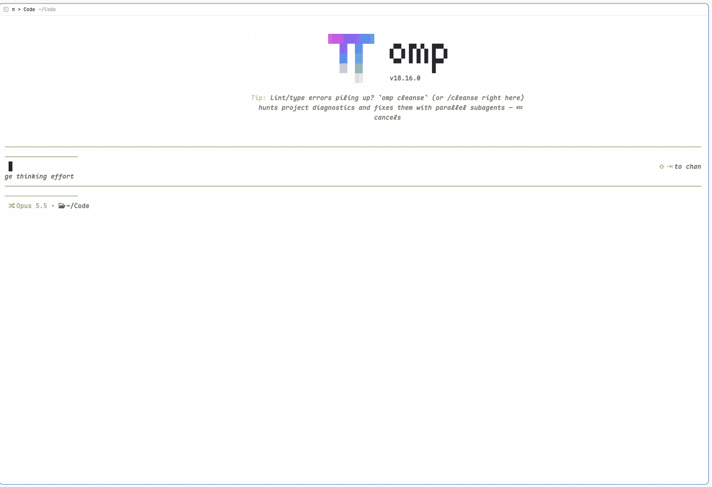

# Sheepdog

Plan → build → verify for one spec, with a separate coding agent for each step, side by side in [Herdr](https://herdr.dev).



*A real run, sped up about 6×: spec Status set to `Herd` → plan → build (Tinker asks Plotter a question) → Nitpick rejects round 1 → fix → signed off, in under 2 minutes.*

Set a spec's Status to `Herd`. The herd opens in its own Herdr space, named after the spec, with four panes:

| | |
|---|---|
| **Herder**: drives the gates, relays messages | **Plotter**: writes `PLAN.md` |
| **Tinker**: builds the FINAL plan | **Nitpick**: re-checks everything, rejects or signs off |

The agents talk to each other directly with `hc send`: Tinker asks Plotter questions, and Nitpick sends rejections back to Tinker until it signs off (or escalates after 3 rounds). The spec's Status ends as `Implemented (sheepdog signed off…)`.

## Why

- **The checker didn't write the code.** A single agent tends to approve its own work. Nitpick re-runs every acceptance check from scratch.
- **Each role starts with a clean context.** Planning exploration doesn't crowd the build.
- **Hard gates in files.** The build starts only when `PLAN.md` says `Status: FINAL`, and the work is done only when `VERDICT.md` says `Verdict: SIGNED-OFF`. The plan, implementation notes and verdict stay as an audit trail.
- **Trigger it and walk away.** It runs in herdr-core, so a herd on a remote box keeps going while your laptop sleeps.
- **You can see and steer every agent.** Unlike hidden subagents, every role is a real pane you can watch, type into or answer.
- **Any agent per role.** For example, omp plans, Claude builds and Codex verifies, so a different model checks the work.

Skip it for small fixes: a herd runs three agents, so it costs roughly three times a single session.

## Requirements

- herdr-core (`hc`) on each machine that runs herds. The Herdr app is optional; it's only needed to see the panes.
- Python 3.9+.
- The agents you configure, installed and logged in on that machine.

## Set it up by asking your agent

Paste this into your coding agent (omp, Claude Code, Codex, …), running in a terminal on the machine where you want herds:

```text
Set up Sheepdog (https://github.com/sundarvisweswaran/sheepdog) on this machine and verify it end to end.

1. Read its README first. Check that herdr-core's `hc` is installed (`hc --version`); if it isn't, stop and tell me to install Herdr from https://herdr.dev/download/.
2. Clone it to ~/code/sheepdog (pull if it's already there) and run `~/code/sheepdog/bin/sheepdog install`.
3. Ask me which agent should run each role: Plotter (plans), Tinker (builds), Nitpick (verifies). Use only agents installed and logged in here; suggest a different model for Nitpick than for Tinker. Write them to ~/.config/sheepdog/config.toml, with whatever flag each agent needs to run without permission prompts, then run `sheepdog install` again.
4. If the Herdr app is installed, set the pane header in my active layout (~/.config/herdr-app/layouts/<layout>.json, "header" → "content" → "mod") to "sheepdog-pane". Change nothing else.
5. Run `sheepdog doctor` and fix anything it reports.
6. Smoke test: create a throwaway git repo ~/code/sheepdog-smoke and a spec ~/code/specs/sheepdog-smoke/spec.md with `| **Status** | Herd |`, `| **Repos** | sheepdog-smoke |`, and one small requirement (e.g. an add(a, b) function with a unit test). Wait with `hc wait sheepdog-smoke-herder` (don't sleep or poll), then confirm the spec's Status says "Implemented (sheepdog signed off…)" and VERDICT.md starts with "Verdict: SIGNED-OFF". Show me the result, then press Enter in the Herder pane (`hc keys sheepdog-smoke-herder enter`) and delete the smoke repo and spec.
7. If I have other machines in `hc machine ls`, ask whether to install there too (`sheepdog install --on <machine>`).
```

## Install

```sh
git clone <this repo> ~/code/sheepdog
~/code/sheepdog/bin/sheepdog install            # this machine
~/code/sheepdog/bin/sheepdog install --on vps   # any machine added with `hc machine add`
sheepdog doctor
```

`install` puts these in place:
- the CLI at `~/.local/bin/sheepdog` and a default `~/.config/sheepdog/config.toml`;
- herdr-core templates `sheepdog-{plotter,tinker,nitpick}`;
- the skill at `~/.agents/skills/sheepdog`, so agents know to offer a herd once a spec is written (they ask first);
- a watcher service (launchd on macOS, `systemd --user` on Linux);
- the `sheepdog-pane` Herdr mod, if the Herdr app is installed.

Re-running it is safe: it refreshes everything and keeps your config.

To see roles in the pane headers, set your layout's pane header to the mod: in `~/.config/herdr-app/layouts/<layout>.json`, change `"header": {"content": {"mod": "pane"}}` to `"mod": "sheepdog-pane"`. Other panes look the same as before.

## Configure

```toml
# ~/.config/sheepdog/config.toml
spec_roots = ["~/code/specs"]
trigger = "Herd"

[roles.plotter]
command = "omp"

[roles.tinker]
command = "claude --dangerously-skip-permissions"

[roles.nitpick]
command = "codex --model gpt-5"
```

Then run `sheepdog install` again.

**Unattended running.** Agents must not stop for permission prompts. Use your agent's own flag (Claude `--dangerously-skip-permissions`, etc.). For omp, Sheepdog adds an overlay that turns off startup plan mode and approval prompts, plus an extension that titles each session `<Role> · <spec>`. Codex automatically gets `--no-daemon`, which hc requires.

**Agents that don't report status to Herdr** get `ready = "quiet"` (wait for the screen to settle). Set it yourself for agents not on the built-in list.

**Role instructions** live in `roles/*.md`. To use your own, put them in `~/.config/sheepdog/roles/<role>.md`.

## Specs

`<spec root>/<folder>/spec.md` (or `SPEC.md`). Sheepdog reads two fields, in any of these forms:

```markdown
| **Status** | Herd |
| **Repos** | my-app (base main), /abs/path/other-repo |
```
or `**Status:** Herd`, or `Status: Herd`. Repo names resolve to `<spec root>/../<name>`. If none resolve, Plotter finds the checkouts and lists them in `PLAN.md`.

## How it works

- `sheepdog watch` (the service) checks the spec roots every 5 s. When it finds the trigger, it sets Status to `In progress (sheepdog)` and runs `sheepdog start`.
- Herder (`sheepdog run`) is a small script in its own pane, not an AI agent. It starts each role with `hc run <template>`. The roles report with `hc send <herder>`, and the messages arrive on Herder's input.
- Panes: each herd gets its own space (one tab, the 2×2 grid). Every terminal carries the `herdr.space` / `herdr.tab` labels. Herder writes the grid into herdr-core's `herdr-app` layout document, so the layout exists even with no window open, and remote herds appear in your Herdr app under that machine. Pressing Enter in Herder after sign-off removes the space.

## Limitations

- The layout uses the Herdr app's layout document (`doc.get` / `doc.set`), which isn't a documented format. If a Herdr update changes it, the grid can break; the pipeline still runs.
- Role agents run without permission prompts. Use it on machines and repos where that's acceptable.
