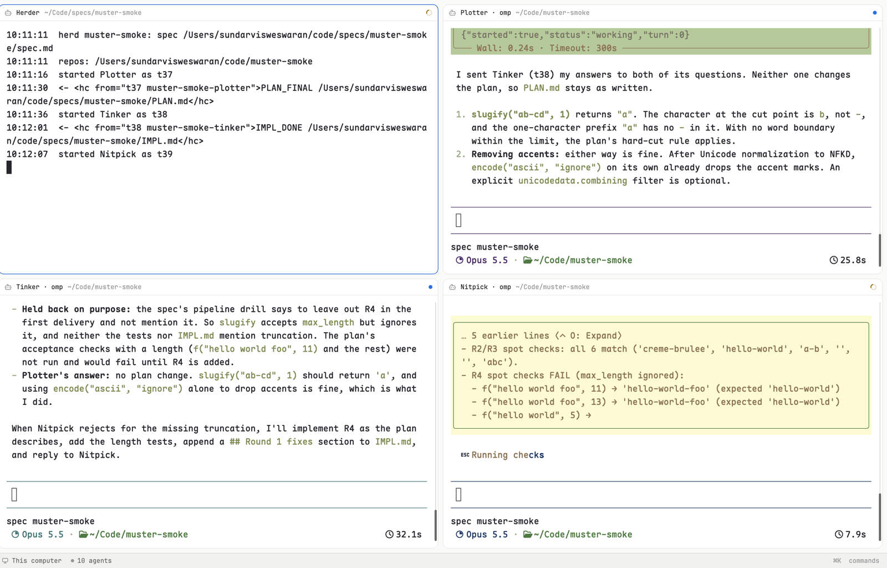

# Muster pane header

A pane header that names each pane's role when it belongs to a Muster herd (plan → build → verify, one agent per role). Herder, Plotter, Tinker and Nitpick panes read `Plotter · omp`, `Tinker · claude` and so on. Every other pane looks exactly as it does with Herdr's shipped `pane` header.

## What you see

- A 30px bar across the top of each pane, in the theme's `background` with a 1px `border` line underneath, 10px horizontal padding, 8px gaps, 12px text.
- From left to right:
  - the program's 14px icon (dim);
  - the label: for a Muster terminal, its role (`Herder`, `Plotter`, `Tinker`, `Nitpick`), then ` · `, then the program name (`Plotter · omp`); if the role and program names match (the Herder script reports `herder`), just the role. For other panes, the shipped header's label: the agent's or shell's program name, else the terminal title, else `shell`. Medium weight, foreground color, truncated at 260px.
  - the pane's folder (dim, `~` for home, truncated, takes the remaining width);
  - a status marker at the right end.

## How it behaves

- **working:** a 12px spinner in the theme's `working` color, one turn per 900 ms.
- **blocked:** a "Needs you" pill, 18px tall, radius 5, `blocked` at 15% opacity behind 10.5px semibold `blocked` text.
- **done:** a 7px round dot in `done`.
- **idle:** no marker.
- **Hover:** four 14px icon buttons appear: split right, split down, zoom/unzoom, close. Each has 3px padding and radius 4; hovering one gives it the `hover` background and foreground color. A click runs `pane.split {direction, pane}`, `pane.zoom {pane}` or `pane.close {pane}` without focusing the pane.
- **Click elsewhere on the bar:** `pane.focus {pane}`.
- Labels update live as terminals start and stop; the mod never polls.

## Built from

- **The mod:** `mods/muster-pane/` is a copy of the shipped `pane` mod (`mod.json`: `"place": "none"`). Its icons `split-right`, `split-down`, `zoom`, `unzoom` and `close` are SVGs referenced as `mods/muster-pane/<name>.svg`. The spinner is the shipped `mods/workspace-chrome/spinner.svg`.
- **Wiring:** a layout uses it as its pane header: `"pane": {"header": {"content": {"mod": "muster-pane"}, "height": 30, "position": "top", "reveal": "always"}}`. Herdr passes `props()` = `{pane, terminal}`.
- **`herdr` calls:**
  - `panes()` finds this pane: program, title, cwd, status, zoomed.
  - `terminals()` reads the terminal's labels.
  - `theme()`, `home()`, and `run()` for the pane commands.
- **Role:** the `muster.role` label (`herder` | `plotter` | `tinker` | `nitpick`) on the core terminal, which Muster sets when it starts each agent. A remote pane's terminal is `machine/tN`. Match it either to a `terminals()` entry with that full address, or to one whose `address` is `tN` and whose `machine` is that machine.
- **No programs, network or outside files.** The rest of Muster (the CLI, the watcher service and the agent templates) is in this repo but isn't part of the mod. See the README.

## Watch out

- Remote terminals: without the machine-aware address match, panes on other machines lose their role and fall back to the program name.
- The shipped label prefers the program name for agents, so an omp pane alone just says "omp". The role has to come from the label, not the title.
- Copy `pane` with `mod.clone` rather than editing the shipped mod. The app restores shipped mods.
- It only changes the header. The 2×2 grid, the spaces and the agents come from the `muster` CLI.

## Done when

- `herdr-app check mods/muster-pane` passes, and `herdr-app status` shows no errors once it is set as the active layout's header.
- In a running herd, the four headers read `Herder`, `Plotter · <agent>`, `Tinker · <agent>`, `Nitpick · <agent>`, including for a herd on another machine.
- A pane that isn't part of a herd shows exactly what the shipped `pane` header shows.
- The status markers and hover buttons behave as above.
